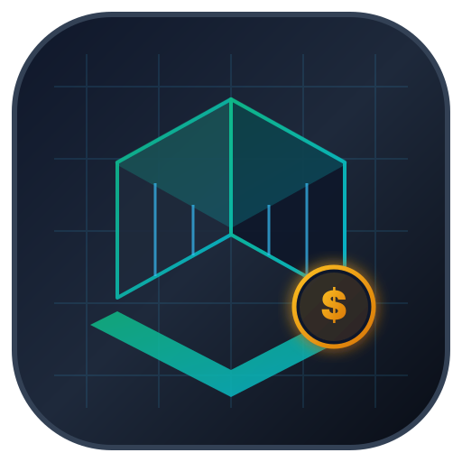

# 📐 Cotizador de Arquitectura

Aplicación web profesional para arquitectos, diseñadores y estudios de visualización 3D para generar, personalizar y exportar cotizaciones detalladas de proyectos (renders, planos arquitectónicos, proyectos ejecutivos, memorias descriptivas y cálculo estructural).



## ✨ Características Principales

- **Gestión Completa de Actividades:** Renders, Planos, Estructural, Proyecto Ejecutivo, Fotomontaje, Memorias.
- **Cálculo Fiscal Automático:** Desglose de Subtotal, Descuentos (fijo o porcentaje), IVA 16%, Retención IVA (10.667%) y Retención ISR (1.25%).
- **Exportación en Alta Calidad a PDF:** Descarga de cotización profesional con logotipo, firma, términos y condiciones legales.
- **Integración con WhatsApp y Correo:** Envío directo del resumen de cotización y mensaje preparado para el contador.
- **Sincronización en la Nube con Supabase:** Guarda y recupera perfiles de configuración, listas de clientes, catálogos de servicios y plantillas de precios.
- **Inteligencia Artificial con Gemini:** Capacidad de generación y estimación inteligente de presupuestos.

## 🚀 Despliegue en Vercel

Esta aplicación está optimizada para ser desplegada en Vercel como un proyecto independiente:

1. Crea un repositorio en GitHub (ej. `cotizador`).
2. Sube el código:
   ```bash
   git init
   git add .
   git commit -m "feat: initial commit cotizador"
   git branch -M main
   git remote add origin https://github.com/Rembrandt7/cotizador.git
   git push -u origin main
   ```
3. En [Vercel](https://vercel.com/new), selecciona **Import** del repositorio `cotizador`.
4. En **Environment Variables**, añade:
   - `GEMINI_API_KEY`: Tu API Key de Google Gemini.
   - `VITE_GEMINI_API_KEY`: Tu API Key de Google Gemini.
5. Haz clic en **Deploy**.

## 💻 Ejecución Local

1. Instala dependencias:
   ```bash
   npm install
   ```
2. Inicia el servidor de desarrollo:
   ```bash
   npm run dev
   ```
